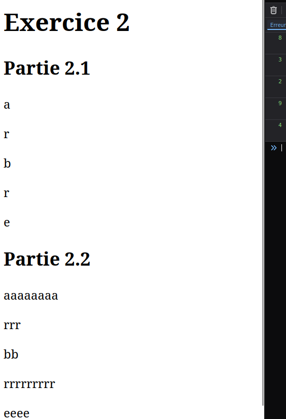

# Série 4
## Exercice 1
1.1 : Affichez dans la console tous les nombres de 1 à 1000

1.2 : Écrire dans la page `HTML` tous les nombres de 1000 à 1 avec `document.write()`

1.3 : Écrire dans la page `HTML` les nombres de 3 à 999, allant de 3 en 3, avec `document.write()`

1.4 : Refaire la même chose qu'en `1.3` mais en créant et ajoutant une balise `<p>` à l'intérieur de laquelle se trouve la valeur

## Exercice 2
Soit : 
```
let mot_choisi = "arbre"

**À compléter**
```
2.1 : Créez une boucle qui, en fonction d'un mot donné, affiche ses lettres à la verticales (càd une par une avec un retour à la ligne entre elles)

2.2 : Tirez un nombre aléatoire `X` entre 0 et 10 pour chaque lettre et affichez-la `X` fois

Exemple :


## Exercice 3
3.1 : Reprenez l'exemple des lancers de dés vu en cours (simuler et ajouter à la page une grande quantité d'images de dés) et modifiez le pour que :
- Le programme n'affiche que les dés impairs
- La bordure des dés `1` soit rouge
- La taille des dés soit proportionnelle à leur valeur
- Les valeurs des dés soient stockées dans un tableau (conseil : utiliser la méthode `.push()`)

3.2 : En écrivant une boucle, calculez la moyenne des lancers du tableau créé en `3.1` (moyenne : somme totale des valeurs du tableau divisé par sa longueur)